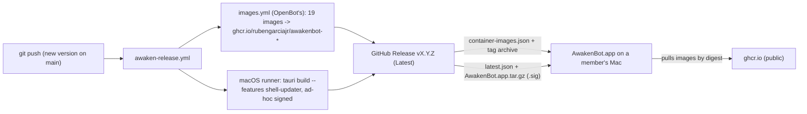

# AwakenBot architecture

AwakenBot is OpenBot with a thin branding and release layer on top. For how OpenBot itself works
(server, Bots, computers, Intelligence), see OpenBot's own [architecture.md](../architecture.md).
This page covers only what AwakenBot adds and how the pieces connect.

## The layer on top of OpenBot

```
brand/                         logo.png (ice orb), updater-public.key
scripts/awaken/brand.ts        name, bundle id, colors, repository (the settings)
scripts/awaken/apply.ts        writes those settings into OpenBot's files (idempotent)
scripts/awaken/version.ts      sets the release version
scripts/awaken-brand-icons.sh  logo.png -> every icon
app/src/awaken/                palette.css (two colors), theme.css (web app tokens)
desktop/src/awaken.css         setup window tokens, logo, no trademark sign
.github/workflows/awaken-release.yml   push a version -> images, Mac app, GitHub Release
project_spec.md, docs/changelog.md, docs/project_status.md, docs/awaken/
```

Everything else is OpenBot's code. Where AwakenBot must change an OpenBot file, `apply.ts` does it,
so the change can be re-made automatically after an upstream merge.

## What `apply.ts` changes

1. **The name.** Whole-word `OpenBot` → `AwakenBot` across app, desktop, shared, extension, server,
   worker, toolkit, supervisor, examples, tests, agent-*, docker-compose.yml and Dockerfile. It
   skips `CopilotKit/OpenBot`, `person/OpenBot` and `~/OpenBot` (repository and path references),
   identifiers such as `OpenBotLogo`, lowercase `openbot`, and `OPENBOT_*`. It also skips
   CopilotKit's release tooling in `desktop/scripts/`, Markdown docs and `.github/`.
2. **The bundle id** `ai.copilotkit.openbot.desktop` → `org.awakenbot.desktop`, everywhere (the app
   finds its config, log and data folders by it).
3. **tauri.conf.json:** product name, window title, identifier, publisher, copyright, category, descriptions.
4. **Colors:** `palette.css` and the two native title-bar colors in `desktop/src-tauri/src/main.rs`.
5. **Imports:** AwakenBot's theme after OpenBot's (`app/src/styles.css`, `desktop/src/main.tsx`).
6. **Usage data:** desktop telemetry off, "Share usage data" default off.
7. **Tests** that pin OpenBot's own choices (publisher, default sharing, the tray icon's colors,
   legacy `~/OpenBot` fixtures), pointed at AwakenBot's.

`bun scripts/awaken/apply.ts --check` fails if anything is left to apply; the release workflow runs it.

## How a member's app gets AwakenBot



- **Compile-time settings** (set by the workflow): `OPENBOT_RELEASE_REPOSITORY`,
  `OPENBOT_DISTRIBUTION_ID` = `rubengarciajr/AwakenBot`, `OPENBOT_RELEASE_CHANNEL=stable`,
  `OPENBOT_SHELL_UPDATE_PUBLIC_KEY` (from `brand/updater-public.key`),
  `OPENBOT_SHELL_UPDATE_ENDPOINT` = `.../releases/latest/download/latest.json`.
- **Install:** the app asks GitHub for the latest release of `rubengarciajr/AwakenBot`, downloads
  `container-images.json` and the tag's `docker-compose.yml`, and pulls the images by digest.
- **Update:** at launch and every six hours the app reads `latest.json`. A newer version shows
  **Update and restart**; the app downloads `AwakenBot.app.tar.gz`, checks its signature against the
  compiled public key, replaces itself and restarts. On the next Start it moves the installation to
  the new release (backing up the database first; rolling back if anything fails).
- **Not used:** CopilotKit's download mirror (only for `CopilotKit/OpenBot` URLs), pinned
  deployments, OpenBot's `publish-release.yml` and signing workflows.

## Known limits

- Ad-hoc signed: the first open needs right-click → **Open**; macOS may ask for microphone access
  again after an update.
- AwakenBot and OpenBot on the same Mac would share Docker Compose project names (`openbot-desktop`).
- Every image pull first tries CopilotKit's mirror for ghcr.io paths, gets refused, then uses ghcr.io.
